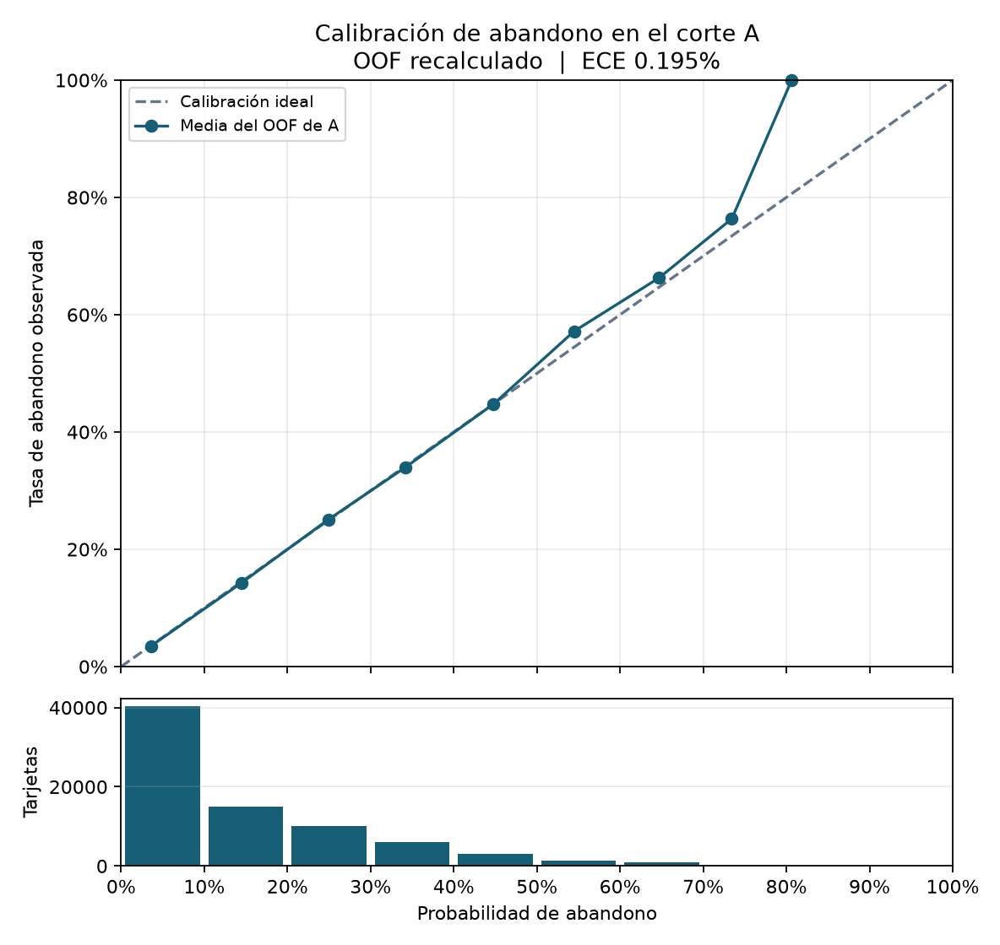
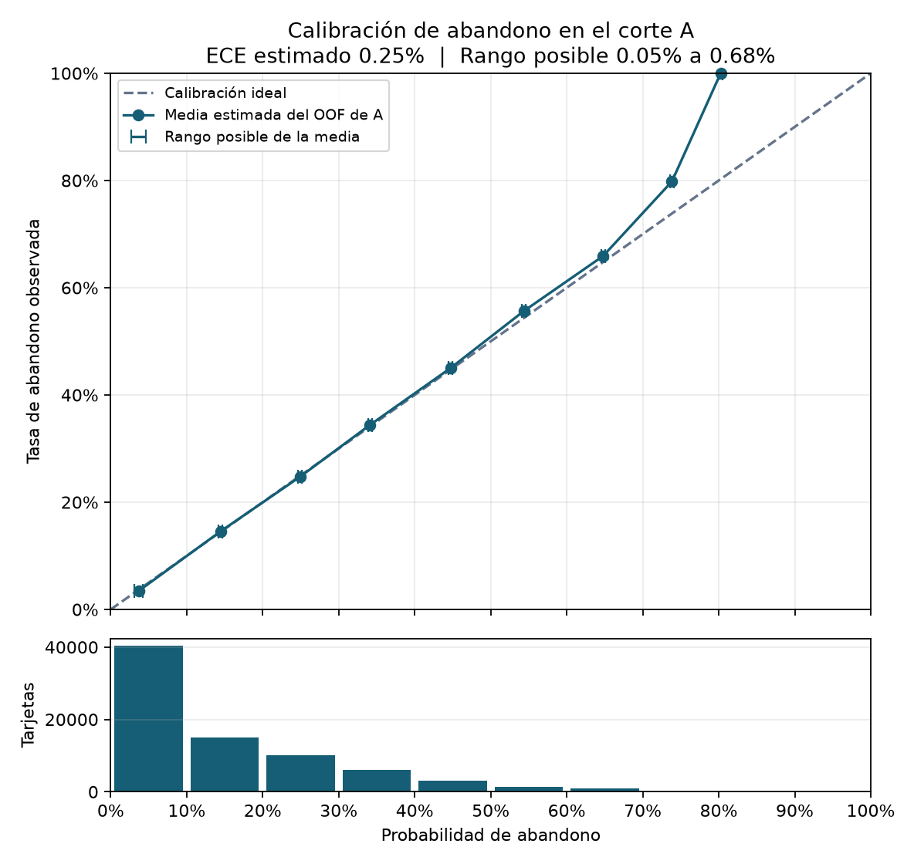

# Calibración de las probabilidades de abandono del corte A

## Curva y ECE calculados sobre el corte A reconstruido

**ECE directo de 0.0019536654**, equivalente a **0.195 puntos porcentuales**. Calculamos una probabilidad fuera de muestra (OOF) por tarjeta en A. La población reconstruida coincide con la registrada en el proyecto: 77,062 tarjetas y 11,100 abandonos. La PR-AUC OOF de esta corrida es 0.43720.



Cada modelo se entrenó con cuatro folds de A y predijo el quinto. Se reutilizó la configuración de HistGradientBoosting regularizado de 2.1 y el esquema de cinco folds estratificados con semilla 42. Para reproducir la asignación en otro equipo, se ordenaron las unidades por operador y llave de tarjeta antes de crear los folds. Ese orden conserva las mismas unidades y usa una asignación distinta de la corrida histórica, que ordenaba por un seudónimo dependiente de la configuración local.

La curva compara la probabilidad media predicha dentro de cada intervalo con la tasa de abandono observada. El ECE pondera la diferencia absoluta entre ambas por el número de tarjetas del intervalo. Se usaron diez intervalos de igual ancho, cerrados a izquierda y abiertos a derecha, con el 1 incluido en el último. Los [agregados por intervalo](p2_calibracion_oof_a_recalculada.json) permiten recalcular el ECE. El intervalo de 80% a 90% contiene solo cuatro tarjetas, por lo que su tasa es inestable. El diagnóstico se limita al corte A.

### Procedencia y reproducción

Los nueve archivos de `P2_datos_red_defensa_120dias.zip` coinciden con los SHA-256 de la columna `sha256_origen` del [registro de la defensa](defensa_2026_11_17/datos_90_procedencia.json). El SHA-256 del ZIP es `42a303e5b66154e1d5a71135bd7b2e916b74685524b4847b13658f413509a5bd`. En la copia de trabajo local se cargaron los CSV de Transmetro y Aerómetro directamente a Bronze con el parser del repositorio. Las columnas de metadatos de Kafka se dejaron nulas, ya que no participan en las ventanas ni en la etiqueta. Se construyeron las features y etiquetas con dbt limitando `cortes_p2` a `{A: "2026-07-01"}`. El recálculo conserva las versiones fijadas en `requirements.txt`.

Para repetir el diagnóstico, construye el warehouse con esos datos y las dependencias documentadas en el [README](../README.md). Si cargas los 120 días con `flows.correr_todo`, usa `--sin-esperados` para comparar la ingesta con el tamaño de esos archivos. Con `LAKE_DIR` apuntando al warehouse, ejecuta:

```bash
python -m modelos.calibracion --reconstruir
```

El comando lee solo A y escribe `p2_calibracion_oof_a_recalculada.json` y `p2_calibracion_oof_a_recalculada.png` en `evidencia/`. Las salidas contienen datos agregados por intervalo.

El barrido original de umbrales se construyó con las predicciones fuera de muestra (OOF) del HistGradientBoosting regularizado en A. Cada tarjeta fue predicha por un modelo entrenado en los otros cuatro folds. Se usaron cinco folds estratificados con semilla 42, 77,062 tarjetas y 11,100 abandonos observados.

## Comparación con el barrido histórico



El [CSV del barrido](p2_2_2_curva_ganancia.csv) conserva los verdaderos positivos y el total de tarjetas con puntaje mayor o igual a cada umbral. Restando los acumulados de dos umbrales consecutivos se recuperan los conteos dentro de cada intervalo. Los agregamos en diez intervalos de igual ancho entre 0 y 1, cerrados a izquierda y abiertos a derecha. El último incluye 1.

Para cada intervalo, la tasa observada es la proporción de tarjetas que abandonaron. Podemos acotar la probabilidad media ponderando los extremos de cada tramo fino del barrido por sus conteos. La gráfica muestra esas cotas con barras horizontales y usa el punto medio como estimación de la probabilidad media. Son límites por la resolución del barrido. El grupo con puntajes de 80% a 90% tiene una sola tarjeta y el siguiente está vacío.

El ECE es la suma de las diferencias absolutas entre tasas observadas y probabilidades medias, ponderadas por la fracción de tarjetas de cada intervalo. Aplicamos la definición de [Guo et al.](https://proceedings.mlr.press/v70/guo17a.html) a la probabilidad de la clase positiva. El **ECE estimado es 0.002503** (0.250 puntos porcentuales). El rango compatible con estos conteos va de **0.00052250 a 0.00680037** (aproximadamente 0.052 a 0.680 puntos porcentuales). El [JSON de evidencia](p2_calibracion_oof_a_acotada.json) incluye tasas, poblaciones, medias estimadas y límites por intervalo.

Este intervalo describe el OOF histórico. El barrido registra conteos, sin almacenar los puntajes individuales de esa corrida. La validación reconstruida usa las mismas especificaciones y otra asignación de tarjetas a los folds.

Con las dependencias del repositorio instaladas, reproduce los límites del barrido histórico desde los archivos versionados.

```bash
python -m modelos.calibracion --desde-conteos
```

Para verificar una reproducción de la corrida histórica con su warehouse original, configura `LAKE_DIR` para que apunte a la carpeta que contiene `warehouse.duckdb`. El comando lee solo A, reconstruye las predicciones OOF con el modelo y los folds originales, y verifica los conteos de todo el barrido y la PR-AUC OOF antes de emitir resultados.

```bash
python -m modelos.calibracion
```

Si ya tienes el OOF original, puedes pasar un CSV con `etiqueta,puntaje` y precisión completa.

```bash
python -m modelos.calibracion --oof /ruta/al/oof_de_A.csv
```

El resultado directo se escribe en `evidencia/p2_calibracion_oof_a.json` y `evidencia/p2_calibracion_oof_a.png`. El comando hace un diagnóstico de A y no evalúa B ni ajusta el modelo entregado o el umbral.
